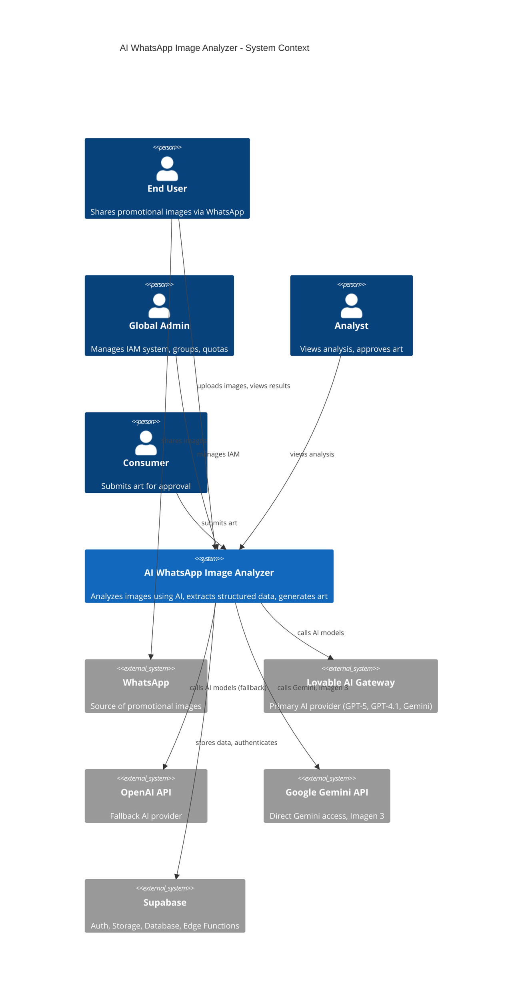

# System Context

> Language: EN | [Português (pt-BR)](../pt-BR/contexto-do-sistema.md)
>
> Status: ACCEPTED
>
> Documentation Standard v1.0

## Purpose

Defines the boundaries of the AI WhatsApp Image Analyzer system, identifying users, external systems, and their interactions.

## System Context Diagram

## Users

| User | Description | Primary interaction |
| --- | --- | --- |
| End User | Shares promotional images via WhatsApp or browser | Upload image, view analysis |
| Global Admin | Manages the IAM system | Groups, users, tokens, quotas |
| Analyst | Views analysis results | Review analysis, approve art |
| Consumer | Submits art for moderation | Submit art, view status |

## External Systems

| System | Purpose | Integration type | Criticality |
| --- | --- | --- | --- |
| WhatsApp | Source of promotional images | Web Share Target (indirect) | High |
| Supabase | Auth, Storage, Database, Edge Functions | REST API | Critical |
| Lovable AI Gateway | Primary AI provider | REST API | High |
| OpenAI API | Fallback AI provider | REST API | Medium |
| Google Gemini API | Direct Gemini, Imagen 3 | REST API | Medium |

## Data Stores

| Store | Purpose | Technology | Classification |
| --- | --- | --- | --- |
| image_analysis | Analysis results, metadata | Supabase Postgres | Confirmed |
| iam_groups | Groups with quotas | Supabase Postgres | Confirmed |
| iam_users | Users with roles | Supabase Postgres | Confirmed |
| iam_api_tokens | API tokens for Edge Functions | Supabase Postgres | Confirmed |
| iam_prompts | AI prompts (vision, art) | Supabase Postgres | Confirmed |
| ai_usage_logs | Cost tracking per model/group | Supabase Postgres | Confirmed |
| art_submissions | Art moderation queue | Supabase Postgres | Confirmed |
| images | Uploaded images | Supabase Storage | Confirmed |
| generated-arts | AI-generated images | Supabase Storage | Confirmed |

## Related Documentation

| Document | Path |
| --- | --- |
| Architecture | [architecture.md](architecture.md) |
| Data flow | [data-flow.md](data-flow.md) |
| Infrastructure | [infrastructure/supabase.md](infrastructure/supabase.md) |
