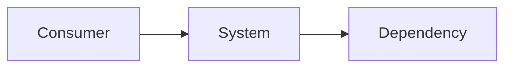

# Architecture

> Language: EN | [Português (pt-BR)](../../pt-BR/templates/architecture.md)
>
> Status: ACCEPTED
>
> Documentation Standard v1.0

Not every section is required for simple projects — mark Not Applicable or omit empty detail while keeping structure scannable. Current state only unless labeled Proposed.

## Purpose

<!-- Why this system exists and what this document covers. -->

## Context

<!-- Users, adjacent systems, environment. -->

## Goals

| Goal | Notes |
| --- | --- |
| | |

## Non-Goals

| Non-goal | Rationale |
| --- | --- |
| | |

## System Boundary

| Inside the system | Outside the system |
| --- | --- |
| | |

## Architecture Overview

## Main Components

| Component | Responsibility | Documentation |
| --- | --- | --- |
| | | |

## Component Relationships

| From | To | Relationship | Contract |
| --- | --- | --- | --- |
| | | depends on / calls / publishes / consumes / other | |

## Data Flow

1.
2.
3.

## Dependencies

| Dependency | Purpose | Failure impact | Classification |
| --- | --- | --- | --- |
| | | | Confirmed / Inferred / Unknown |

## Interfaces

| Interface | Provider | Consumers | Contract |
| --- | --- | --- | --- |
| | | | |

## Security Boundaries

| Boundary | What is protected | Controls summary |
| --- | --- | --- |
| | | |

## Failure Domains

| Domain | Includes | Failure effect |
| --- | --- | --- |
| | | |

## Quality Attributes

| Attribute | Requirement | Target | Current State | Evidence |
| --- | --- | --- | --- | --- |
| | | Target not identified | | |

## Architectural Constraints

| ID | Description | Source | Impact | Current Status |
| --- | --- | --- | --- | --- |
| CON-XXX | | | | Active / Proposed / Retired / Unknown |

## Trade-offs

| Decision / approach | Benefit | Cost |
| --- | --- | --- |
| | | |

## Known Limitations

| Limitation | Impact | Classification |
| --- | --- | --- |
| | | Confirmed / Inferred / Unknown |

## Related ADRs

| ADR | Title | Status |
| --- | --- | --- |
| ADR-XXX | | |

## Related Contracts

| Contract | Role |
| --- | --- |
| | |

## Related Documentation

| Document | Path |
| --- | --- |
| Project overview | |
| System context | |
| Security | |
| Observability | |