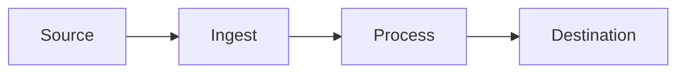

# Data Flow

> Language: EN | [Português (pt-BR)](../../pt-BR/templates/data-flow.md)
>
> Status: ACCEPTED
>
> Documentation Standard v1.0

Document how data moves for one meaningful flow. Current state only unless labeled Proposed.

## Purpose

<!-- What this flow accomplishes and when it runs. -->

## Source

| Field | Value | Classification |
| --- | --- | --- |
| Origin | | Confirmed / Inferred / Unknown |
| Producer / actor | | |
| Trigger | | |

## Input

| Field / part | Type | Required | Description |
| --- | --- | --- | --- |
| | | yes / no | |

## Validation

| Check | When | On failure |
| --- | --- | --- |
| | | |

<!-- Mark Not Applicable if no validation step exists. -->

## Transformation

| Step | Input shape | Output shape | Notes |
| --- | --- | --- | --- |
| | | | |

<!-- Mark Not Applicable if data is passed through unchanged. -->

## Processing

| Step | Component | Sync / async / other | Notes |
| --- | --- | --- | --- |
| | | | |

## Persistence

| Store / sink | What is stored | Lifecycle | Classification |
| --- | --- | --- | --- |
| | | | Confirmed / Inferred / Unknown / Not Applicable |

## Transport

| Hop | Mechanism | Contract | Classification |
| --- | --- | --- | --- |
| | | | Confirmed / Inferred / Unknown / Not Applicable |

## Destination

| Destination | Consumer | Outcome |
| --- | --- | --- |
| | | |

## Failure Handling

| Failure | Detection | Response | Classification |
| --- | --- | --- | --- |
| | | | Confirmed / Inferred / Unknown / Not Applicable |

## Security Considerations

| Topic | Summary |
| --- | --- |
| Sensitivity | |
| Controls crossing boundaries | |
| Risks | |

<!-- Never document secret values. -->

## Observability

| Signal | Status | Notes |
| --- | --- | --- |
| Logging | Implemented / Partial / Not Applicable / Not Documented | |
| Metrics | Implemented / Partial / Not Applicable / Not Documented | |
| Tracing | Implemented / Partial / Not Applicable / Not Documented | |

## Flow Diagram

## Related Components

| Component | Role in this flow |
| --- | --- |
| | |

## Related Contracts

| Contract | Role |
| --- | --- |
| | |