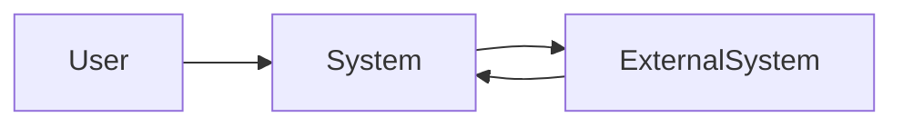

# System Context

> Language: EN | [Português (pt-BR)](../../pt-BR/templates/system-context.md)
>
> Status: ACCEPTED
>
> Documentation Standard v1.0

Use real names from the project; do not invent fictional actors for real systems.

## Purpose

<!-- Answer: where does this system fit in the ecosystem? -->

## System

| Field | Value |
| --- | --- |
| Name | |
| Purpose | |
| Owner | |
| Boundary summary | |

## Users

| User | Need | Interaction |
| --- | --- | --- |
| | | |

## Consumers

| Consumer | What they consume | Contract |
| --- | --- | --- |
| | | |

## External Systems

| External system | Role | Direction | Classification |
| --- | --- | --- | --- |
| | | inbound / outbound / bidirectional | Confirmed / Inferred / Unknown |

## Dependencies

| Dependency | Type | Purpose | Classification |
| --- | --- | --- | --- |
| | runtime / data / operational / other | | Confirmed / Inferred / Unknown |

## Inputs

| Input | Source | Format / contract |
| --- | --- | --- |
| | | |

## Outputs

| Output | Destination | Format / contract |
| --- | --- | --- |
| | | |

## Relevant Relations

| From | To | Relation | Notes |
| --- | --- | --- | --- |
| | | depends on / calls / publishes / consumes / other | |

## Context Diagram

## Related Documentation

| Document | Path |
| --- | --- |
| Architecture | |
| Data flow | |
| Contracts | |