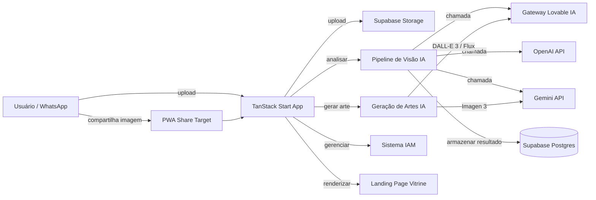

# Arquitetura

> Language: [English (EN)](../en/architecture.md) | Português (pt-BR)
>
> Status: ACCEPTED

## Propósito

Este documento descreve a arquitetura do AI WhatsApp Image Analyzer — uma aplicação SSR em TanStack Start com backend Supabase, integração multi-provedor de IA, sistema IAM e recursos PWA.

## Contexto

Os usuários interagem com a aplicação através de um navegador web (desktop ou mobile). No mobile, imagens podem ser compartilhadas diretamente do WhatsApp via Web Share Target API. A aplicação processa imagens através de modelos de visão de IA, armazena resultados no Supabase e apresenta análise estruturada.

| Elemento de contexto | Papel |
| --- | --- |
| Usuário final | Compartilha imagens promocionais para análise |
| Empresário | Gerencia portfólio via landing page da vitrine |
| Global admin | Gerencia sistema IAM (grupos, usuários, tokens, cotas) |
| Analista | Visualiza resultados de análise, aprova artes |
| Consumidor | Submete artes para moderação |
| Supabase | Backend (Auth, Storage, DB, Edge Functions) |
| Provedores de IA | Análise de visão e geração de imagem |

## Objetivos

| Objetivo | Notas |
| --- | --- |
| Análise automatizada de imagens | Extrair dados estruturados de imagens promocionais via IA |
| Suporte multi-provedor de IA | Gateway Lovable, OpenAI, Gemini com cotas por grupo |
| IAM com acesso baseado em roles | Global admin, analyst, consumer com cotas em BRL |
| PWA com Web Share Target | Receber imagens diretamente do WhatsApp |
| Landing page da vitrine | Exibição de portfólio de negócios via WhatsApp |
| Geração de artes | Criar imagens promocionais a partir do conteúdo analisado |

## Não-Objetivos

| Não-objetivo | Justificativa |
| --- | --- |
| Análise em streaming em tempo real | Modelo de processamento em lote escolhido |
| SaaS multi-tenant | Deploy de projeto Supabase único |
| Treinamento de ML customizado | Utiliza modelos de visão pré-treinados |

## Fronteira do Sistema

| Dentro do sistema | Fora do sistema |
| --- | --- |
| TanStack Start SSR app | WhatsApp (fonte de imagens) |
| Supabase (Auth, Storage, DB, Edge Functions) | Provedores de IA (OpenAI, Gemini, gateway Lovable) |
| Sistema IAM | Dashboard do projeto Supabase |
| Landing page da vitrine | Dispositivos dos usuários finais |
| Pipeline de geração de artes | |

## Visão Geral da Arquitetura

## Componentes Principais

| Componente | Responsabilidade | Documentação |
| --- | --- | --- |
| TanStack Start App | Roteamento SSR, renderização UI, server functions, middleware | [arquitetura.md](arquitetura.md) |
| Pipeline de Visão IA | Download de imagem, seleção de provedor, execução de prompt, parsing/validação JSON | [arquitetura.md](arquitetura.md) |
| Geração de Artes IA | Processamento de imagem de referência, chamadas DALL-E 3/Flux/Imagen 3, gestão de galeria | [arquitetura.md](arquitetura.md) |
| Sistema IAM | Roles, grupos, cotas, API tokens, rastreamento de uso | [arquitetura.md](arquitetura.md) |
| Landing Page Vitrine | Renderização de portfólio de negócios com contato WhatsApp | [arquitetura.md](arquitetura.md) |
| Backend Supabase | Auth, Storage, Postgres, Edge Functions, RLS | [infraestrutura/supabase.md](infraestrutura/supabase.md) |

## Relacionamentos de Componentes

| De | Para | Relacionamento | Contrato |
| --- | --- | --- | --- |
| TanStack Start App | Backend Supabase | chama | REST (client JS Supabase) |
| TanStack Start App | Gateway Lovable IA | chama | REST (chat completions, images) |
| TanStack Start App | OpenAI API | chama | REST (chat completions, images) |
| TanStack Start App | Gemini API | chama | REST (generateContent, predict) |
| Pipeline de Visão IA | Supabase Storage | lê | download compatível com S3 |
| Pipeline de Visão IA | Supabase Postgres | escreve | Drizzle ORM |
| Geração de Artes IA | Supabase Storage | escreve | upload compatível com S3 |
| Sistema IAM | Supabase Postgres | lê/escreve | Drizzle ORM |
| Edge Function | Supabase Postgres | lê/escreve | client JS Supabase |

## Fluxo de Dados

### Principal: Análise de Imagem

1. Usuário faz upload da imagem (drag-drop, seletor de arquivo ou Web Share Target)
2. Imagem enviada ao bucket `images` do Supabase Storage
3. URL assinada criada (expiração de 7 dias)
4. Hash perceptual (pHash 8x8) calculado para deduplicação
5. Registro `image_analysis` criado com status `pending`
6. Server function `analyzeImage` invocada com seleção de provedor
7. Provedor de IA selecionado: gateway Lovable / OpenAI / Gemini (por cota de grupo)
8. Imagem baixada do Storage, convertida para dataURL
9. Prompt de visão executado com resposta SSE em streaming
10. Resposta JSON parseada (extração via regex de fence/braces)
11. Resposta validada contra o schema Zod
12. Registro `image_analysis` atualizado (status `completed`, searchable_text, keywords)
13. Cota do grupo debitada (R$0,05 por análise)
14. Uso registrado em `ai_usage_logs`

### Secundário: Geração de Artes

1. Usuário solicita geração de arte a partir do resultado da análise
2. Imagem de referência recuperada da análise
3. Provedor selecionado: DALL-E 3/Flux via gateway Lovable OU Imagen 3 via Gemini
4. Imagem gerada (resposta b64_json)
5. Imagem gerada enviada para `generated-arts/{uuid}.jpg`
6. URL assinada criada (expiração de 30 dias)
7. `image_gallery` atualizado no JSONB da análise
8. Cota do grupo debitada (R$0,15 por geração)

## Dependências

| Dependência | Propósito | Impacto de falha | Classificação |
| --- | --- | --- | --- |
| Supabase | Auth, Storage, DB, Edge Functions | Falha completa da aplicação | Confirmed |
| Gateway Lovable IA | Provedor de IA primário | Fallback para OpenAI/Gemini | Confirmed |
| OpenAI API | Provedor de IA fallback | Opções de provedor reduzidas | Confirmed |
| Google Gemini API | Acesso direto Gemini, Imagen 3 | Sem recursos específicos do Gemini | Confirmed |
| TanStack Start | Framework SSR | Falha de build | Confirmed |
| Bun | Runtime/gerenciador de pacotes | Workflow de desenvolvimento afetado | Confirmed |

## Interfaces

| Interface | Provedor | Consumidores | Contrato |
| --- | --- | --- | --- |
| Supabase REST API | Supabase | TanStack Start App, Edge Function | [infraestrutura/supabase.md](infraestrutura/supabase.md) |
| Gateway Lovable IA | Lovable | TanStack Start App | REST chat completions, images |
| OpenAI API | OpenAI | TanStack Start App | REST chat completions, images |
| Gemini API | Google | TanStack Start App, Edge Function | REST generateContent, predict |
| Web Share Target | Navegador | TanStack Start App | POST /share-target |

## Fronteiras de Segurança

| Fronteira | O que protege | Resumo de controles |
| --- | --- | --- |
| RLS do Supabase | Linhas do banco | Políticas por tabela para anon/authenticated |
| Roles IAM | Operações de admin | Verificações de role (global_admin, analyst, consumer) |
| Middleware CSRF | Server functions | Validação de token em handlerType=serverFn |
| Auth por API token | Edge Function | Lookup por hash SHA-256, verificação de expiração |
| Supabase Auth | Sessões de usuário | Autenticação baseada em JWT |

## Domínios de Falha

| Domínio | Inclui | Efeito de falha |
| --- | --- | --- |
| Provedores de IA | Gateway Lovable, OpenAI, Gemini | Análise/geração indisponível |
| Supabase | Auth, Storage, DB, Edge Functions | Falha completa da aplicação |
| Navegador do Cliente | PWA, Service Worker | Web Share Target indisponível |

## Atributos de Qualidade

| Atributo | Requisito | Alvo | Estado Atual | Evidência |
| --- | --- | --- | --- | --- |
| Disponibilidade | Aplicação acessível | 99% uptime | Unknown | Sem SLI definido |
| Tempo de resposta | Conclusão da análise de imagem | < 30s | Unknown | Sem métricas |
| Precisão | Validação de schema JSON | 100% saída válida | Implementado | Validação Zod |
| Escalabilidade | Análises concorrentes | Não definido | Unknown | Projeto Supabase único |

## Restrições Arquiteturais

| ID | Descrição | Fonte | Impacto | Status Atual |
| --- | --- | --- | --- | --- |
| CON-001 | Conectado ao Lovable — sem force-push de histórico publicado | Lovable | Restrições no fluxo Git | Active |
| CON-002 | Projeto Supabase single-region | Supabase | Sem failover multi-região | Active |
| CON-003 | Disponibilidade do modelo depende de provedores externos | Externo | Análise indisponível durante falhas | Active |

## Trade-offs

| Decisão / abordagem | Benefício | Custo |
| --- | --- | --- |
| Multi-provedor de IA | Redundância, flexibilidade por grupo | Maior complexidade na seleção de provedor |
| Supabase como backend único | Desenvolvimento rápido, serviços integrados | Vendor lock-in, single-region |
| PWA com Web Share Target | Compartilhamento nativo do WhatsApp | Limitações de suporte de navegador |
| Fallback IAM em localStorage | Funciona sem tabelas IAM | Risco de inconsistência de dados |

## Limitações Conhecidas

| Limitação | Impacto | Classificação |
| --- | --- | --- |
| Sem notificações em tempo real | Usuários devem fazer polling pelos resultados | Confirmed |
| Projeto Supabase único | Sem failover multi-região | Confirmed |
| Hash perceptual 8x8 | Baixa resistência a colisão para imagens similares | Confirmed |
| Débito de cota síncrono | Análise bloqueada se a verificação de cota falhar | Inferred |

## ADRs Relacionados

| ADR | Título | Status |
| --- | --- | --- |
| ADR-001 | [Seleção da Stack Tecnológica](decisoes/adr-001-stack-tecnologico.md) | Accepted |

## Contratos Relacionados

| Contrato | Papel |
| --- | --- |
| Análise de Visão IA | Inbound: imagem + params, Outbound: JSON estruturado |
| Geração de Artes IA | Inbound: análise + prompt, Outbound: imagem gerada |
| Verificação de Cota IAM | Inbound: group_id, Outbound: status da cota |

## Documentação Relacionada

| Documento | Caminho |
| --- | --- |
| Visão geral do projeto | [visao-geral.md](visao-geral.md) |
| Contexto do sistema | [contexto-do-sistema.md](contexto-do-sistema.md) |
| Fluxo de dados | [fluxo-de-dados.md](fluxo-de-dados.md) |
| Segurança | [seguranca/seguranca.md](seguranca/seguranca.md) |
| Infraestrutura | [infraestrutura/supabase.md](infraestrutura/supabase.md) |
| Operações | [operacoes/perfil-do-servico.md](operacoes/perfil-do-servico.md) |