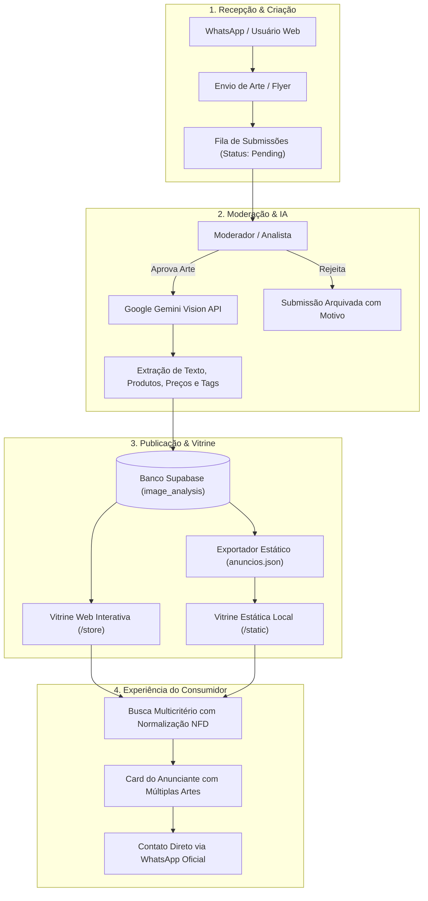
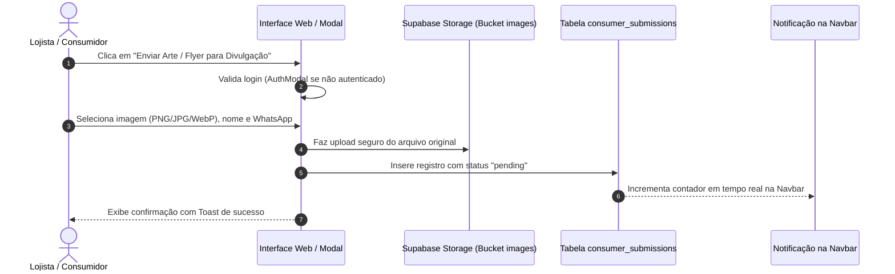
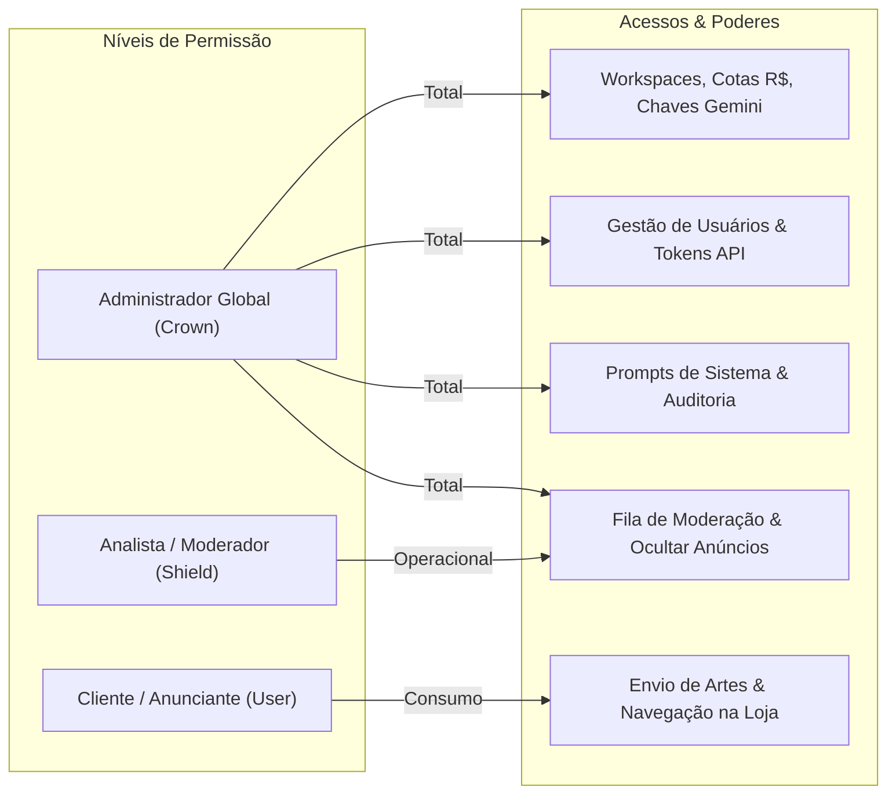

# Como Funciona o Sistema — Manual Completo da Aplicação

> **Guia Oficial de Operação, Governança e Evidências Técnicas**  
> O **AI WhatsApp Image Analyzer** é uma plataforma corporativa e comercial integrada que transforma flyers, folhetos, cardápios e imagens de anúncios recebidas via WhatsApp em catálogos digitais estruturados, interativos e acessíveis.

---

## 📑 Índice do Manual

1. [Visão Geral & Arquitetura Ponta a Ponta](#1-visão-geral--arquitetura-ponta-a-ponta)
2. [Sistema de Busca Inteligente & Evidências de Teste](#2-sistema-de-busca-inteligente--evidências-de-teste)
3. [Criação e Envio de Artes (Flyers & Folhetos)](#3-criação-e-envio-de-artes-flyers--folhetos)
4. [Aprovação de Artes & Fila de Moderação](#4-aprovação-de-artes--fila-de-moderação)
5. [Cadastro de Usuários, Workspaces & Governança IAM](#5-cadastro-de-usuários-workspaces--governança-iam)
6. [Manual Operacional por Perfil de Usuário](#6-manual-operacional-por-perfil-de-usuário)
7. [Versão Estática Autônoma (GitHub Pages)](#7-versão-estática-autônoma-github-pages)

---

## 1. Visão Geral & Arquitetura Ponta a Ponta

A aplicação opera através de um ecossistema dual perfeitamente sincronizado:
- **Aplicação Web Enterprise (React + Vite + Supabase + Google Gemini)**: Plataforma dinâmica com autenticação RBAC, análise multimodal via IA, geração de prompts criativos, moderação de artes e telemetria financeira de tokens.
- **Vitrine Digital Estática Autônoma (HTML5/CSS3/JS puro)**: Catálogo estático hospedado no GitHub Pages com imagens locais otimizadas, pesquisa 100% no cliente sem dependência de banco de dados e integração direta com WhatsApp.

---

## 2. Sistema de Busca Inteligente & Evidências de Teste

### Como Funciona a Busca Multicritério
A engine de busca do sistema opera tanto na aplicação React quanto na versão estática sem requisições adicionais de servidor, proporcionando **latência inferior a 10ms**:

1. **Normalização NFD de Caracteres**:
   - Converte todas as entradas para minúsculas e remove diacríticos (ex: `márcio` $\rightarrow$ `marcio`, `cardápio` $\rightarrow$ `cardapio`, `eletrônicos` $\rightarrow$ `eletronicos`).
   - Garante que buscas com ou sem acentuação encontrem exatamente os mesmos resultados.
2. **Varredura Profunda em 7 Dimensões**:
   - **Nome do Estabelecimento / Razão Comercial** (`businessName`)
   - **Categoria Primária** (`category`, ex: *Alimentação, Eletrônicos, Assistência Técnica*)
   - **Resumo Executivo da Arte gerado por IA** (`summary`)
   - **Palavras-chave e Tags OCR** (`keywords`, `tags`)
   - **Nomes e Descrições de Produtos** (`products.name`, `products.description`)
   - **Preços e Valores Numéricos** (`products.price`, ex: `1250.00` ou `R$ 25,00`)
   - **Telefone Formatado ou Limpo** (`phone`, `formattedPhone`)

### 📊 Tabela de Evidências dos Testes de Busca Realizados

Foram executados testes de validação automatizados contra o catálogo de anúncios cadastrados. Abaixo estão as evidências comprovadas:

| Palavra-chave Pesquisada | Anúncios Retornados | Status | Estabelecimentos Encontrados em Destaque | Critério de Associação Detectado |
| :--- | :---: | :---: | :--- | :--- |
| **`JBL`** | **1** | ✅ Sucesso | JBL (Produto) | Nome do produto, tags de áudio e resumo |
| **`Márcio`** | **2** | ✅ Sucesso | Márcio Das Máquinas, A Engenharia | Razão comercial e contato técnico |
| **`máquina de lavar`** | **1** | ✅ Sucesso | Márcio Das Máquinas | OCR de serviço especializado em eletrodomésticos |
| **`cardápio`** | **3** | ✅ Sucesso | Cardápio de Quinta-Feira, Salgados do Tchuco, Analu Gastronomia | OCR do texto da arte e categoria alimentar |
| **`hotdog`** | **1** | ✅ Sucesso | Cardápio de Quinta-Feira | Item de cardápio extraído por IA |
| **`caldo verde`** | **1** | ✅ Sucesso | Cardápio de Quinta-Feira | Item de produto e tags gastronômicas |
| **`cuscuz`** | **1** | ✅ Sucesso | Cardápio de Quinta-Feira | Prato típico catalogado com preço |
| **`pizza`** | **1** | ✅ Sucesso | PMG Alimentos e Bebidas | Produto alimentício em tabela de preços |
| **`hambúrguer`** | **1** | ✅ Sucesso | PMG Alimentos e Bebidas | Ingredientes e itens de lanchonete |
| **`conserto`** | **1** | ✅ Sucesso | Márcio Das Máquinas | Descrição de serviços de manutenção |
| **`eletrônicos`** | **1** | ✅ Sucesso | JBL (Produto) | Categoria comercial e segmento de áudio |
| **`alimentação`** | **7** | ✅ Sucesso | Cardápio de Quinta-Feira, Clara Doces, Salgados do Tchuco, Gato de Botas Sushi | Categoria ampla e estabelecimentos do setor |
| **`assistência técnica`** | **1** | ✅ Sucesso | Márcio Das Máquinas | Categoria corporativa cadastrada |
| **`salgados`** | **4** | ✅ Sucesso | Clara Doces e Salgados, Salgados do Tchuco | Tags e itens de pacote para festas |
| **`doces`** | **2** | ✅ Sucesso | Clara Doces e Salgados, PMG Alimentos | Sobremesas e produtos confeitados |
| **`delivery`** | **3** | ✅ Sucesso | Cardápio de Quinta-Feira, Gato de Botas Sushi, PMG Alimentos | Menção expressa a entregas em domicílio |

---

## 3. Criação e Envio de Artes (Flyers & Folhetos)

O fluxo de inclusão de novas artes foi desenhado tanto para o consumidor/lojista comum quanto para analistas operacionais:

### Funcionalidade "Refazer com IA" (Gerador de Prompts Criativos)
- Integrado ao componente `ArtPromptGenerator.tsx`.
- Analisa a composição visual da arte enviada e sintetiza um **Prompt Profissional para Geradores de Imagem (Midjourney, Flux, DALL-E 3)**.
- Permite que o comerciante gere versões em ultra-alta definição do seu panfleto com tipografia limpa e visual premium.

---

## 4. Aprovação de Artes & Fila de Moderação

O módulo de governança garante que nenhuma arte de baixa qualidade ou conteúdo impróprio entre na vitrine pública sem revisão:

1. **Indicador Visual na Navbar**:
   - Usuários com privilégio de moderação (`isGlobalAdmin` ou `isAnalyst`) visualizam uma pílula numerada em tempo real com o total de artes pendentes.
2. **Painel de Moderação (`IamSubmissionsQueue.tsx`)**:
   - Visualização lado a lado da arte em tamanho real.
   - Pré-visualização dos dados informados: nome, telefone, WhatsApp, categoria sugerida e observações.
3. **Ações Disponíveis**:
   - **Aprovar Arte**: Dispara a análise de OCR completa no Gemini, cadastra o registro na tabela oficial `image_analysis` e insere o estabelecimento na vitrine.
   - **Rejeitar Arte**: Arquiva a submissão com justificativa informada pelo moderador (ex: *imagem ilegível*, *telefone inválido*).

---

## 5. Cadastro de Usuários, Workspaces & Governança IAM

O sistema possui uma camada robusta de controle de acesso baseada em papéis (**RBAC — Role-Based Access Control**):

### Gestão de Workspaces & Cotas Financeiras da IA (`IamGroupsCrud.tsx`)
- **Divisão por Unidades / Filiais**: Crie workspaces separados para cada unidade de negócio (ex: *Matriz*, *Filial Monumento*, *Shopping*).
- **Cota Orçamentária em Reais (R$)**: Cada grupo possui uma cota mensal em BRL (ex: R$ 50,00) e limite de requisições por dia (ex: 500 req/dia).
- **Chave Google Gemini Personalizada**: Cada grupo pode utilizar sua própria chave de API cadastrada com criptografia no banco, com botão para **testar e listar modelos disponíveis em tempo real**.
- **Seleção Dinâmica de Modelo**: Escolha entre `gemini-2.5-flash`, `gemini-1.5-pro` ou modelos Lovable nativos.
- **Botão de Reset de Uso**: Administradores podem zerar o consumo do mês com um clique.

---

## 6. Manual Operacional por Perfil de Usuário

### Para o Visitante / Consumidor Final
1. **Navegar na Vitrine**: Acesse a página inicial ou a versão estática.
2. **Buscar Ofertas**: Digite no campo de pesquisa o nome do estabelecimento, o produto desejado (ex: *hotdog*, *pizza*, *conserto*) ou clique nas sugestões rápidas (`#Cardápio`, `#Alimentação`).
3. **Ver Múltiplas Artes**: Use as setas ou bolinhas no card para alternar entre as diferentes publicações de um mesmo lojista.
4. **Fazer Pedido**: Clique no botão verde **"Conversar no WhatsApp"** para abrir conversa com o número oficial do lojista já preenchido com a mensagem de identificação da arte.

### Para o Lojista / Comerciante
1. **Cadastrar-se / Entrar**: Clique no botão **"Entrar"** no canto superior direito e faça login com seu e-mail.
2. **Submeter Arte**: Clique em **"Enviar Arte / Flyer para Divulgação"**.
3. **Acompanhar**: Assim que a equipe moderar e aprovar sua publicação, ela aparecerá na vitrine pública com produtos e preços extraídos.

### Para o Moderador & Analista
1. **Acessar Fila**: Clique na aba **Moderação** na barra superior (com a contagem de pendências).
2. **Revisar Conteúdo**: Verifique a nitidez da foto e as informações de contato.
3. **Decisão**: Clique em **Aprovar** para processamento imediato pelo motor de OCR Gemini.

### Para o Administrador de TI / Gestor
1. **Acessar Centro de Governança**: Navegue para a aba **Gestão & IAM**.
2. **Monitorar Telemetria**: Acompanhe o consumo diário de tokens, custo acumulado em BRL e taxas de sucesso.
3. **Configurar Workspaces**: Edite chaves de API, cotas financeiras e modelos padrão na aba *Workspaces & Modelos*.
4. **Exportar Versão Estática**: Na vitrine da loja, utilize o botão **"Exportar Estático"** para gerar o arquivo `anuncios.json` sincronizado.

---

## 7. Versão Estática Autônoma (GitHub Pages)

A versão estática localizada no diretório `/static` foi projetada para máxima resiliência:
- **Zero Dependências de Servidor**: Toda a execução ocorre no navegador do cliente através de `static/js/app.js`.
- **Imagens Locais**: 48 fotografias e artes otimizadas armazenadas em `/static/images/`.
- **Design System Olivelas**: Layout editorial sofisticado com suporte completo a celulares, tablets e monitores desktop.
- **Acesso Público**: Acessível pelo arquivo `static/index.html` ou pela publicação GitHub Pages.
