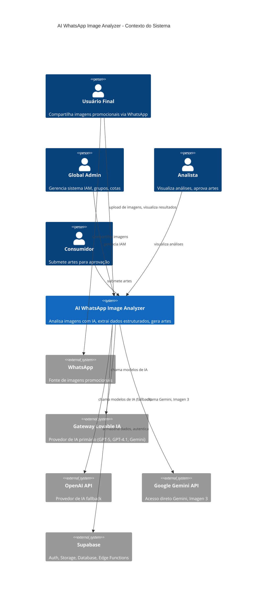

# Contexto do Sistema

> Language: [English (EN)](../en/system-context.md) | Português (pt-BR)
>
> Status: ACCEPTED

## Propósito

Define as fronteiras do sistema AI WhatsApp Image Analyzer, identificando usuários, sistemas externos e suas interações.

## Diagrama de Contexto do Sistema

## Usuários

| Usuário | Descrição | Interação principal |
| --- | --- | --- |
| Usuário Final | Compartilha imagens promocionais via WhatsApp ou navegador | Upload de imagem, visualização de análise |
| Global Admin | Gerencia o sistema IAM | Grupos, usuários, tokens, cotas |
| Analista | Visualiza resultados de análise | Revisão de análise, aprovação de artes |
| Consumidor | Submete artes para moderação | Submeter arte, visualizar status |

## Sistemas Externos

| Sistema | Propósito | Tipo de integração | Criticidade |
| --- | --- | --- | --- |
| WhatsApp | Fonte de imagens promocionais | Web Share Target (indireto) | Alta |
| Supabase | Auth, Storage, Database, Edge Functions | API REST | Crítica |
| Gateway Lovable IA | Provedor de IA primário | API REST | Alta |
| OpenAI API | Provedor de IA fallback | API REST | Média |
| Google Gemini API | Gemini direto, Imagen 3 | API REST | Média |

## Data Stores

| Store | Propósito | Tecnologia | Classificação |
| --- | --- | --- | --- |
| image_analysis | Resultados de análise, metadados | Supabase Postgres | Confirmed |
| iam_groups | Grupos com cotas | Supabase Postgres | Confirmed |
| iam_users | Usuários com roles | Supabase Postgres | Confirmed |
| iam_api_tokens | API tokens para Edge Functions | Supabase Postgres | Confirmed |
| iam_prompts | Prompts de IA (visão, arte) | Supabase Postgres | Confirmed |
| ai_usage_logs | Rastreamento de custo por modelo/grupo | Supabase Postgres | Confirmed |
| art_submissions | Fila de moderação de artes | Supabase Postgres | Confirmed |
| images | Imagens enviadas | Supabase Storage | Confirmed |
| generated-arts | Imagens geradas por IA | Supabase Storage | Confirmed |

## Documentação Relacionada

| Documento | Caminho |
| --- | --- |
| Arquitetura | [arquitetura.md](arquitetura.md) |
| Fluxo de dados | [fluxo-de-dados.md](fluxo-de-dados.md) |
| Infraestrutura | [infraestrutura/supabase.md](infraestrutura/supabase.md) |