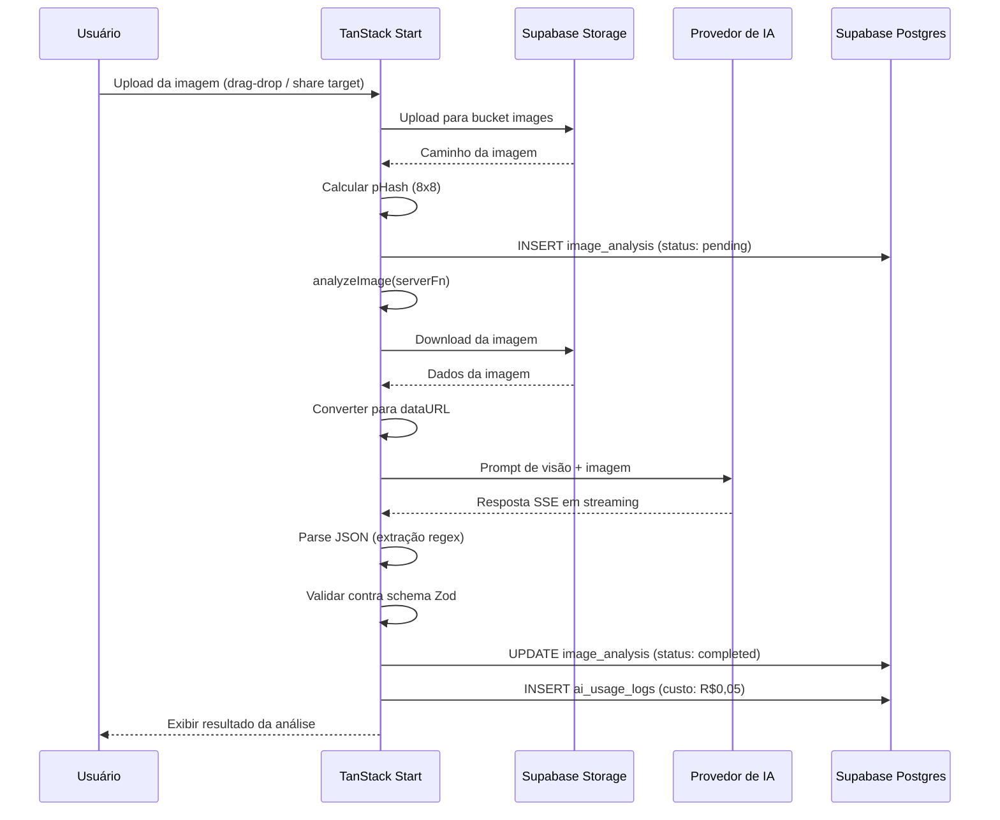
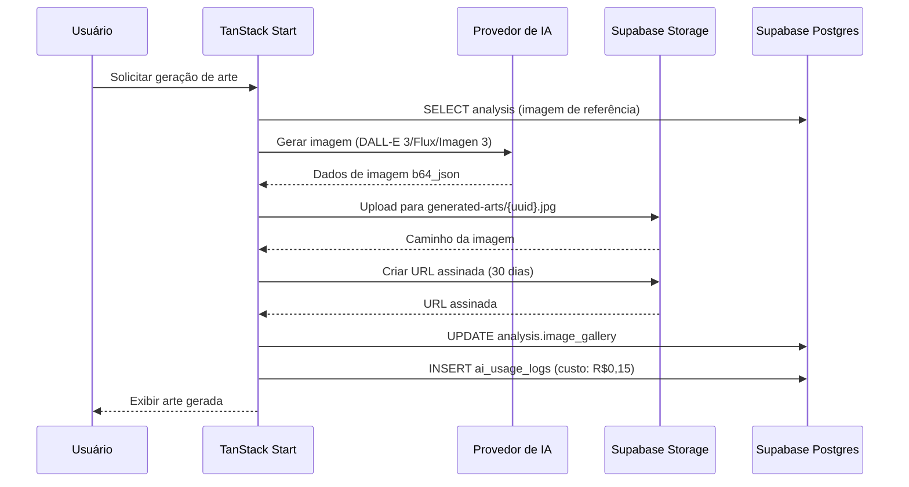
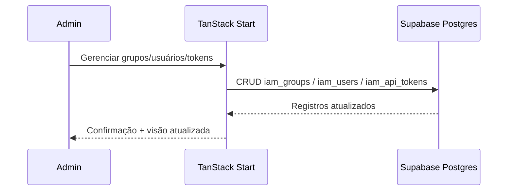
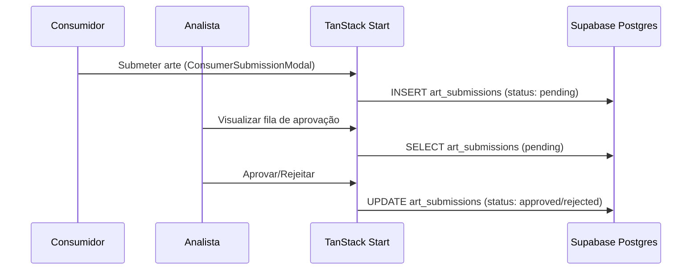
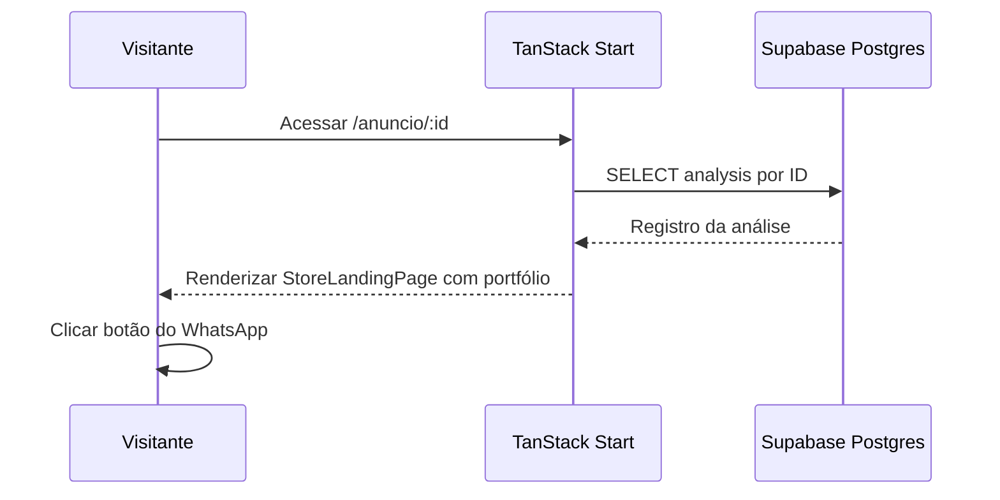

# Fluxo de Dados

> Language: [English (EN)](../en/data-flow.md) | Português (pt-BR)
>
> Status: ACCEPTED

## Propósito

Descreve os fluxos de dados primários através do sistema AI WhatsApp Image Analyzer.

## Fluxo 1: Análise de Imagem (Principal)

### Entidades de Dados

| Entidade | Fonte | Destino | Formato |
| --- | --- | --- | --- |
| Arquivo de imagem | Dispositivo do usuário | Supabase Storage | JPEG/PNG/WebP |
| URL assinada | Supabase Storage | Servidor da aplicação | URL (expiração 7 dias) |
| pHash | Cálculo da aplicação | image_analysis.phash | Matriz binária 8x8 |
| Prompt de visão | iam_prompts / ANALYSIS_PROMPT | Provedor de IA | String |
| Resposta da IA | Provedor de IA | Servidor da aplicação | JSON SSE em streaming |
| Resultado da análise | Validação da aplicação | image_analysis.analysis | JSONB |
| Log de uso | Servidor da aplicação | ai_usage_logs | Linha (custo, modelo, status) |

### Schema: image_analysis

| Coluna | Tipo | Propósito |
| --- | --- | --- |
| id | uuid | Chave primária |
| image_url | text | URL assinada da imagem |
| image_path | text | Caminho no storage |
| image_type | text | Tipo MIME |
| business_name | text | Nome do negócio extraído |
| category | text | Categoria da imagem |
| title | text | Título extraído |
| summary | text | Resumo gerado pela IA |
| searchable_text | text | Conteúdo para busca full-text |
| keywords | text[] | Palavras-chave extraídas |
| confidence | numeric | Confiança da IA (0-1) |
| analysis | jsonb | JSON estruturado completo |
| phash | text | Hash perceptual |
| processing_version | text | Versão do prompt/modelo |
| model_used | text | Identificador do modelo de IA |
| status | text | pending/processing/completed/failed |
| error_message | text | Detalhes do erro se falhou |
| created_at | timestamptz | Hora de criação do registro |

## Fluxo 2: Geração de Artes

## Fluxo 3: Gestão IAM

## Fluxo 4: Moderação de Artes

## Fluxo 5: Landing Page da Vitrine

## Documentação Relacionada

| Documento | Caminho |
| --- | --- |
| Arquitetura | [arquitetura.md](arquitetura.md) |
| Contexto do sistema | [contexto-do-sistema.md](contexto-do-sistema.md) |
| Contratos | [contratos/](contratos/) |