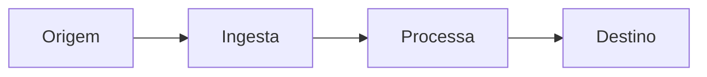

# Fluxo de Dados

> Language: [English (EN)](../../en/templates/data-flow.md) | Português (pt-BR)
>
> Status: ACCEPTED
>
> Documentation Standard v1.0

Documente como os dados se movem para um fluxo significativo. Estado atual apenas, a menos que rotulado como Proposed.

## Propósito

<!-- O que este fluxo realiza e quando é executado. -->

## Fonte

| Campo | Valor | Classificação |
| --- | --- | --- |
| Origem | | Confirmed / Inferred / Unknown |
| Produtor / ator | | |
| Gatilho | | |

## Entrada

| Campo / parte | Tipo | Obrigatório | Descrição |
| --- | --- | --- | --- |
| | | sim / não | |

## Validação

| Verificação | Quando | Em falha |
| --- | --- | --- |
| | | |

<!-- Marque Não aplicável se não houver etapa de validação. -->

## Transformação

| Etapa | Formato de entrada | Formato de saída | Notas |
| --- | --- | --- | --- |
| | | | |

<!-- Marque Não aplicável se os dados passam sem mudança. -->

## Processamento

| Etapa | Componente | Síncrono / assíncrono / outro | Notas |
| --- | --- | --- | --- |
| | | | |

## Persistência

| Store / destino | O que é armazenado | Ciclo de vida | Classificação |
| --- | --- | --- | --- |
| | | | Confirmed / Inferred / Unknown / Não aplicável |

## Transporte

| Salto | Mecanismo | Contrato | Classificação |
| --- | --- | --- | --- |
| | | | Confirmed / Inferred / Unknown / Não aplicável |

## Destino

| Destino | Consumidor | Resultado |
| --- | --- | --- |
| | | |

## Tratamento de Falhas

| Falha | Detecção | Resposta | Classificação |
| --- | --- | --- | --- |
| | | | Confirmed / Inferred / Unknown / Não aplicável |

## Considerações de Segurança

| Tópico | Resumo |
| --- | --- |
| Sensibilidade | |
| Controles cruzando fronteiras | |
| Riscos | |

<!-- Nunca documente valores de secrets. -->

## Observabilidade

| Sinal | Status | Notas |
| --- | --- | --- |
| Logging | Implementado / Parcial / Não aplicável / Não documentado | |
| Metrics | Implementado / Parcial / Não aplicável / Não documentado | |
| Tracing | Implementado / Parcial / Não aplicável / Não documentado | |

## Diagrama de Fluxo

## Componentes Relacionados

| Componente | Papel neste fluxo |
| --- | --- |
| | |

## Contratos Relacionados

| Contrato | Papel |
| --- | --- |
| | |