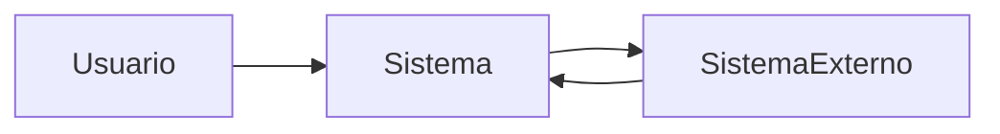

# Contexto do Sistema

> Language: [English (EN)](../../en/templates/system-context.md) | Português (pt-BR)
>
> Status: ACCEPTED
>
> Documentation Standard v1.0

Use nomes reais do projeto; não invente atores fictícios para sistemas reais.

## Propósito

<!-- Responda: onde este sistema se encaixa no ecossistema? -->

## Sistema

| Campo | Valor |
| --- | --- |
| Nome | |
| Propósito | |
| Proprietário | |
| Resumo da fronteira | |

## Usuários

| Usuário | Necessidade | Interação |
| --- | --- | --- |
| | | |

## Consumidores

| Consumidor | O que consomem | Contrato |
| --- | --- | --- |
| | | |

## Sistemas Externos

| Sistema externo | Papel | Direção | Classificação |
| --- | --- | --- | --- |
| | | inbound / outbound / bidirecional | Confirmed / Inferred / Unknown |

## Dependências

| Dependência | Tipo | Propósito | Classificação |
| --- | --- | --- | --- |
| | runtime / data / operacional / outro | | Confirmed / Inferred / Unknown |

## Entradas

| Entrada | Fonte | Formato / contrato |
| --- | --- | --- |
| | | |

## Saídas

| Saída | Destino | Formato / contrato |
| --- | --- | --- |
| | | |

## Relações Relevantes

| De | Para | Relação | Notas |
| --- | --- | --- | --- |
| | | depende de / chama / publica / consome / outro | |

## Diagrama de Contexto

## Documentação Relacionada

| Documento | Caminho |
| --- | --- |
| Arquitetura | |
| Fluxo de dados | |
| Contratos | |